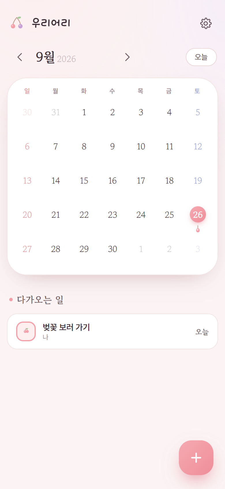
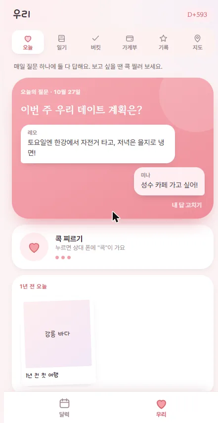
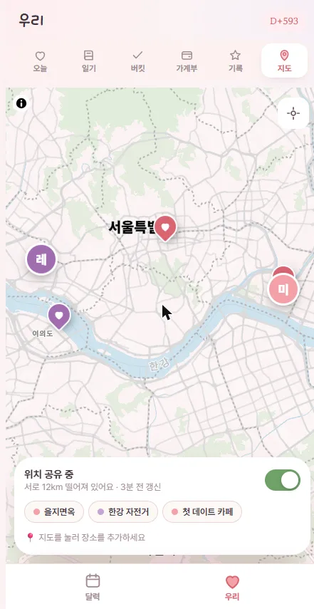
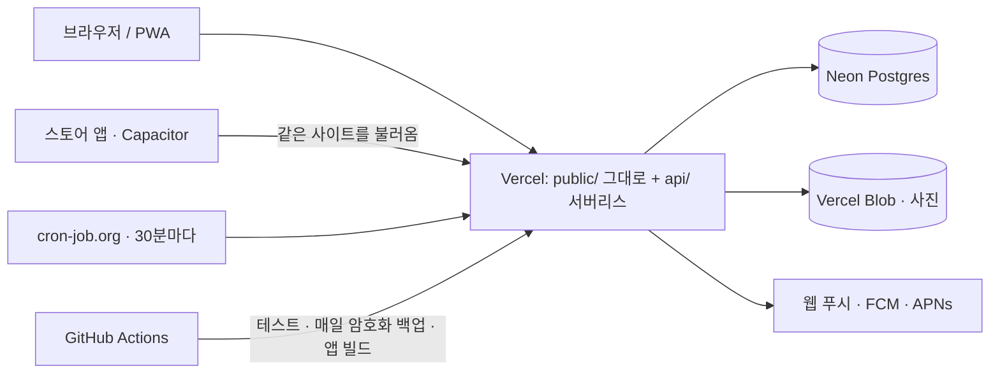

# TT

[English](README.md) · **한국어**

둘이 같이 쓰는 캘린더를 **직접 띄워 쓰는** 오픈소스. 그래서 우리 일정은 커플 앱
회사의 서버가 아니라 **우리 DB에** 남습니다. 각자 로그인하고 한 명이 상대를 초대하면
그때부터 달력 하나를 같이 씁니다. 한쪽이 일정을 넣으면 **상대 폰 잠금화면에 알림이
뜨고,** 일정 당일 아침에도 한 번 더 알려줍니다. 카톡도 다른 앱도 거치지 않고 이 앱이
직접 보냅니다.

<p align="center">

</p>

| | |
|---|---|
| **한 줄** | 15분, 무료로 직접 띄우는 커플 캘린더 — 데이터는 내 Postgres에. 프레임워크·빌드 없는 순수 자바스크립트 |
| **링크** | [tt-calendar.vercel.app](https://tt-calendar.vercel.app)(만든 사람의 사본) · [소개](https://tt-calendar.vercel.app/ko/) · [사귄 지 며칠 계산기](https://tt-calendar.vercel.app/ko/days-together/) |
| **데모** |  · [mp4](docs/demo/demo.mp4) — 25초, 실서비스의 데모 커플 |
| **상태** | 오픈소스(MIT). 웹(PWA)으로 돌아가고, Capacitor 스토어 앱은 CI에서 빌드되지만 스토어에 올리지는 않았습니다. 직접 띄우기: [코드 없이 설치하기](docs/GUIDE.md) · [코딩 에이전트용](AGENTS.md) · [오래 굴리기](docs/RUNNING.md) |
| **기술** | 순수 JS · Vercel 서버리스(함수 12개 이하, 테스트로 지킴) · Neon Postgres · Vercel Blob · 웹 푸시 / FCM / APNs · Capacitor |
| **테스트** | 743개, `npm test` (메모리 Postgres에 대고 도는 실제 핸들러, 화면, 다국어, 공휴일, 서비스 워커, 공개 페이지) |
| **비용** | 월 0원 (무료 플랜) |
| **더 읽기** | [어떻게 돌아가나](#어떻게-돌아가나) · [왜 이렇게 만들었나](#왜-이렇게-만들었나) |

<p>




</p>

- **빌드가 없습니다.** 번들러도 프레임워크도 없어요. `public/`이 그대로 서빙됩니다
- **런타임 의존성 세 개** — `@neondatabase/serverless`, `web-push`, `@vercel/blob`.
  안드로이드(FCM)·아이폰(APNs) 알림은 SDK 없이 fetch와 Node 내장 http2로 보냅니다
- **계정과 커플별 달력** — 구글 하나로(ID 토큰을 구글 공개키로 직접 확인, 비밀번호 없음), 초대 링크, 탈퇴.
  모든 쿼리가 커플로 걸러지고, 두 커플 테스트가 모든 창구를 두드려 새는지 봅니다
- **스토어 앱** — Capacitor로 감싼 얇은 껍데기(`android/`, `ios/`)에 OS 알림. Mac 없이 CI에서
  빌드합니다 ([docs/APPS.md](docs/APPS.md))
- **일정 알림** — 시간이 있는 일정은 30분~1시간 전에, 아침 8시엔 오늘 일정 모아서 한 번. 쓰는 곳의 시간대로
- **"우리" 탭**(달력 옆 아래 탭) — 오늘의 질문(나도 답해야 상대 답이 열리고, 저녁 8시에 아직 안 한 사람에게만 알림), 사진 일기·앨범과
  아침 요약의 "1년 전 오늘", 버킷리스트, 데이트 가계부, 장소·맛집·문화를 별점과 모으는 우리 지도(가까운 순 목록·지금 있는 곳 저장·길찾기), 콕 찌르기(하루 3번),
  위치 공유(**둘 다** 켰을 때만, 마지막 위치 하나만, 끄면 바로 지움). 달력 오른쪽 위 단추로 한눈에 보기. 서버 함수는 `api/together.js` 하나 더
- **첫 진입은 한 화면에 할 일 하나** — 구글 로그인 → "뭐라고 불러 드릴까요?"(구글 이름이 미리 채워짐) → 홈 화면 추가
  한 번(안드로이드는 버튼 한 번 → 시스템 설치 창, 아이폰은 사파리가 웹의 설치를 막아서 3단계 그림 안내) → 사용법. 홈 화면에 두면 앱처럼 열립니다 (PWA)
- **검색엔진·AI가 읽는 공개 페이지** — 소개 페이지와 "사귄 지 며칠" 계산기를 9개 언어로. `landing.mjs`가
  FAQ 구조화 데이터·hreflang·sitemap·`llms.txt`까지 만듭니다

`api/`·`lib/`·`public/`에 약 15,000줄(언어팩 9개 포함). 실제 핸들러를 메모리 Postgres에 붙여 돌리는
통합 테스트 435개, 화면을 직접 돌리는 테스트 224개, 언어·공휴일 테스트 58개, 서비스 워커 테스트 16개.

## 우리 데이터는 우리 DB에

커플 앱은 대부분 일기·사진·일정을 그 회사 서버에 둡니다. TT는 **둘이 직접 띄워 쓰는** 걸 전제로
만들었습니다 ([코드 없이 설치하기](docs/GUIDE.md), 약 15분, 무료):

- **내 DB.** 일정·메모·사진은 *내* 계정의 Neon Postgres와 Vercel Blob에 들어갑니다. 이 코드를 만든
  사람을 포함해 다른 누구도 들어갈 수 없고, 프로젝트와 DB를 지우면 전부 사라집니다
- **분석·광고·추적 없음.** 쓰는 걸 지켜보는 외부 스크립트가 없습니다. 화면은 글꼴 두 개(구글 폰트, jsDelivr)와
  구글 로그인 버튼만 불러오고, 그쪽에 가는 건 그 요청뿐 — 달력 내용은 가지 않습니다. "우리" 탭 지도를 열 때만
  unpkg에서 MapLibre를, `tiles.openfreemap.org`에서 지도 데이터(OpenStreetMap)를 받습니다 — 어느 동네를 보는지는 알아도, 핀과 위치는
  브라우저 안에서 그려서 가지 않습니다
- **구글은 누군지만 확인합니다.** 로그인은 ID 토큰을 내 서버가 구글 공개키로 확인하는 것뿐, 일정은 구글로 가지 않습니다
- **웹 알림은 종단 간 암호화.** 웹 푸시 내용은 받는 브라우저만 풀 수 있게 암호화되어(`aes128gcm`) 푸시 서버는
  읽지 못하고 전달만 합니다. (스토어 앱이 쓰는 FCM·APNs는 이렇게 암호화하지 않습니다 — 스토어에 올리지 않았고,
  웹 앱만으로 충분합니다)
- **위치 공유는 둘 다 동의해야.** 공유를 켜고 "우리" 탭을 열어 둔 동안에만, 1분에 한 번까지 올라갑니다. 마지막 위치
  하나만 남고, 상대도 켜야 서로 보이며, 끄면 바로 지워집니다
- **코드가 공개.** 모든 쿼리가 커플로 걸러지고, `test.mjs`가 두 커플로 모든 창구를 두드려 서로 새지 않는지 봅니다 — 직접 읽어 보세요

서버 기계는 여느 클라우드 앱처럼 호스팅 회사(Vercel·Neon)가 돌립니다. 다른 점은, 데이터가 모두의 것을 모아 두는
서비스가 아니라 *내가* 가진 계정 안에 있다는 것입니다.

## 어떻게 돌아가나



| 부품 | 여기서 하는 일 | 어디 |
|---|---|---|
| **Vercel** | `public/`을 그대로 내주고 `api/`를 서버리스 함수로 돌립니다. 배포 하나로 모든 커플을 받고, `main`에 푸시하면 배포됩니다 | `vercel.json`, `api/` |
| **Neon Postgres** | 표 18개, 달력의 모든 줄에 `couple_id`. 미리보기 배포마다 DB 복사본 브랜치가 따로 생겨서 시험하다 진짜 달력을 건드릴 일이 없습니다 | `schema.sql`, `lib/store.js` |
| **Vercel Blob** | 달력 사진(비공개). DB에는 사진이 어디 있는지만 적힙니다 | `lib/blob.js` |
| **바깥 시계** | 30분마다 `/api/cron`을 두드려 "곧 시작" 알림, 아침 8시 요약, 저녁 8시 오늘의 질문을 보냅니다. 달력마다 그 사람들의 시간대로 | `api/cron.js`, `lib/remind.js` |
| **암호화 백업** | GitHub Actions가 매일 밤 DB를 떠서 GPG로 잠근 뒤 30일 보관합니다. 레포가 공개라 암호 없이는 열 수 없어야 해서요 | `.github/workflows/backup.yml` |
| **PWA** | 매니페스트, 신호 없이도 열리게 하는 서비스 워커, 크롬·엣지 설치 버튼과 아이폰 그림 안내 | `public/sw.js`, `api/manifest.js` |
| **스토어 앱** | 같은 사이트를 감싼 Capacitor 껍데기에 OS 알림. 안드로이드 `.aab`와 iOS TestFlight 빌드를 Mac 없이 CI에서 만듭니다 | `android/`, `ios/`, `.github/workflows/` |

## 왜 이렇게 만들었나

- **프레임워크·빌드 없음.** 화면은 HTML 하나, 스크립트 하나, 스타일 하나. 배포 사이에 올릴 버전도
  깨질 빌드도 없고, 스토어 앱도 똑같은 파일을 불러옵니다
- **런타임 의존성 셋.** FCM·APNs는 서명한 JWT와 `fetch`(애플은 Node `http2`)로, 구글 로그인은 ID 토큰을
  구글 공개키로 `crypto`가 직접 확인합니다. SDK를 하나 뺄 때마다 살피고 올려야 할 것이 하나 줄어요
- **서비스 하나에 여러 커플, 격리는 테스트로.** `lib/store.js`의 모든 함수가 커플을 먼저 받고, 누가 어느
  자리(a/b)인지는 요청 본문이 아니라 세션이 정합니다. 두 커플 테스트가 모든 창구를 두드려 새는지 봅니다
- **구글 하나, 비밀번호 없음.** 샐 것도, 재설정할 것도 없습니다. 로그인은 HttpOnly 쿠키, 세션과 초대 코드는
  해시로만 저장합니다
- **앱이 스스로 차립니다.** 첫 요청이 `schema.sql`을 돌리고 VAPID 키를 만들고, 파일이 바뀌면 스키마를 다시
  돌립니다. 새로 배포할 때 필요한 건 DB 주소 하나
- **진짜 Postgres로, 메모리에서 테스트.** PGlite가 실제 SQL을 돌려서 `npm test`에 계정이 필요 없고 푸시마다
  돕니다. 화면은 `public/app.js`를 가짜 DOM에 올려 직접 돌립니다
- **무료 한도에 맞춘 설계.** 30분 간격으로 두드리면 그 사이 Neon이 잠들어 한 달 무료 컴퓨트 100시간 중
  30시간 남짓만 씁니다. Vercel 함수 12개 한도는 테스트가 지킵니다
- **알림 규칙은 시각만 받는 순수 함수**라 자정, UTC 서쪽 시간대 같은 경우를 테스트에서 마음대로 넣어 봅니다
- **처음 보는 사람을 위해.** 화면의 모든 글자는 언어팩을 거치고, [`AGENTS.md`](AGENTS.md)만 있으면
  코딩 에이전트가 만든 사람 없이 설치합니다

## 깔기

### 터미널을 써본 적이 없다면

[**단계별 가이드**](docs/GUIDE.md)(영어)를 따라 하세요. 전부 브라우저에서 합니다 —
Deploy 버튼 하나, 5분쯤. 키와 표는 앱이 처음 켜질 때 알아서 만듭니다. 둘이 쓸 한 벌이 깔려요.

### AI에게 맡기기 (제일 쉬움)

이 저장소를 받아서, 그 폴더에서 Claude Code나 Codex 같은 CLI 에이전트를 켜고
이렇게 물어보세요.

```
이거 어떻게 써?
```

[`AGENTS.md`](AGENTS.md)에 설치 절차가 에이전트가 읽을 수 있게 적혀 있습니다.
프로젝트 이름만 정해주면 나머지는 알아서 합니다. 브라우저 로그인 한 번(`vercel login`)만
직접 해주시면 됩니다.

### 직접 하기

계정이 이미 있으면 5분입니다. Neon은 따로 가입 안 해도 됩니다 — Vercel 통합이
계정까지 만들어줍니다.

```bash
npm install
npx vercel login
npx vercel link --yes
npx vercel integration add neon        # DATABASE_URL이 들어갑니다

npx vercel env pull .env.local
npm run verify                         # ✗는 고치고 ⚠는 읽어보기
npx vercel deploy --prod
```

꼭 넣어야 하는 환경변수는 없습니다. 알림용 VAPID 키는 앱이 첫 요청 때 만들어 DB에
두고(`lib/setup.js`), 표도 같은 때 만들어요. 사진용 Blob, 구글 로그인용 클라이언트 ID,
아침 알림 시계 열쇠(`CRON_SECRET`), 스토어 앱 알림 키(FCM·APNs)는 선택이고
[`AGENTS.md`](AGENTS.md#first-install)에 정리돼 있습니다.

**다른 커플도 가입하게 하면 서비스를 운영하는 것입니다.** Vercel Hobby는 개인 용도만
허용해서 Pro가 필요하고, 시계가 하루 종일 돌면 Neon도 유료가 필요합니다
([`docs/RUNNING.md`](docs/RUNNING.md)).

`npm run verify`가 ✗를 내면 고치는 명령을 같이 알려줍니다.

## 알림 켜기

**설정 → 휴대폰 알림 → 알림 받기.** 기기마다 한 번씩 눌러야 합니다. 스토어 앱은 알아서 물어봅니다.

**아이폰은 홈 화면에 추가한 앱에서만 켜집니다.** 사파리 탭에서는 버튼이 눌리지
않아요. 공유 → "홈 화면에 추가" → 그 아이콘으로 열어서 켜주세요. (iOS 16.4+)

안드로이드와 데스크톱 크롬은 그냥 됩니다.

## 내 것으로 바꾸기

**설정 화면에서 되는 것** — 앱 이름, 인사말, 두 사람 이름, 처음 만난 날, 테마,
달력 사진. 코드를 안 건드립니다. **저장 버튼은 없습니다.** 적거나 고르면 바로 담겨요.

**파일만 갈아끼우면 되는 것**

| 파일 | 어디에 |
|---|---|
| `public/mascot.png` | 로그인 화면의 큰 그림 |
| `public/favicon.png` | 브라우저 탭 · 알림창 아이콘 |
| `public/badge.png` | 폰 상단바 알림 아이콘 |

`badge.png`만 규칙이 있습니다. **안드로이드가 알파(모양)만 씁니다** — 색은 시스템이
칠해요. 컬러 사진을 넣으면 뭉개진 덩어리가 됩니다. 96px에 흰색 + 알파로 저장하세요.

**코드를 고쳐야 하는 것**

- **테마 추가** — `style.css`의 `[data-theme="..."]` 블록을 복사해 값만 갈고,
  `app.js`의 `THEMES` 배열에 id를 넣고, 언어팩에 `theme.<id>` 키를 더합니다.
  고르는 칸의 미리보기는 저절로 생깁니다
- **홈 화면 기본 이름·아이콘** — `public/manifest.default.json`, `public/icon-512.png`. 커플마다 앱 안에서
  자기 이름과 아이콘을 고를 수 있습니다(처음 들어올 때 한 번, 그 뒤엔 설정 → 홈 화면 아이콘).
  `/manifest.json`은 `api/manifest.js`가 그 선택대로 내줍니다

## 언어

영어·한국어·일본어·중국어(간체)·스페인어·프랑스어·독일어·포르투갈어(브라질)·러시아어,
아홉 언어로 나옵니다. **설정 → 언어**에서 바꾸면 둘 다 바뀝니다 — 같이 쓰는
설정이라서요. 아무도 안 골랐으면 브라우저 언어를 따릅니다. 날짜·시각·요일 이름은
`Intl`이 만들어서 언어를 따라갑니다.

언어팩은 키와 값만 적힌 파일 하나입니다. 라이브러리도 빌드도 없습니다.

```
public/i18n/en.js     기준이 되는 파일
public/i18n/ko.js     ja.js · zh-CN.js · es.js · fr.js · de.js · pt-BR.js · ru.js
```

하나 더 넣으려면 `en.js`를 복사해 값만 옮기고, `index.html`에 `<script>` 한 줄,
`i18n/index.js`의 `LOCALE_NAMES`에 이름 한 줄, 알림에도 쓰이게 `lib/i18n.js`에
import 한 줄을 더하면 됩니다. 빠뜨린 키는 빈칸이
아니라 영어로 나옵니다. `npm run i18n`이 어디까지 됐는지 알려줍니다.

서버도 같은 파일을 써서, 휴대폰 알림도 정한 언어로 옵니다.

## 공휴일

**설정 → 공휴일**에서 나라를 고릅니다. 나라 하나가 파일 하나예요.

```
public/holidays/none.js   기본값 (안 씀)
public/holidays/calc.js   부활절·"몇째 주 무슨 요일" 계산 (여러 나라가 같이 씀)
public/holidays/kr.js     대한민국. 음력 명절과 대체공휴일까지
public/holidays/jp.js     일본. 대체휴일과 국민의 휴일까지
public/holidays/cn.js     중국 본토. 법정 공휴일 (음력 날짜는 2036년까지)
public/holidays/us.js     미국 연방 공휴일. 주말이면 옮겨 쉬는 날까지
public/holidays/de.js     독일. 전국 공통 공휴일만
public/holidays/fr.js     프랑스 본토
public/holidays/es.js     스페인. 전국 공통 공휴일만
public/holidays/br.js     브라질. 전국 공휴일
public/holidays/ru.js     러시아. 공휴일 당일만
```

음력에 매인 명절은 계산으로 못 구해서 2036년까지 적어뒀고, 대체공휴일은 규칙대로
알아서 붙습니다. 지역 공휴일이나 정부가 해마다 따로 정하는 날(중국의 주말 맞바꾸기,
러시아의 휴일 이동)은 계산할 수 없어서 빠져 있어요 — 무엇이 빠졌는지는 파일마다
맨 위에 적혀 있습니다.

## 알아둘 것

- **첫 접속이 1~2초 걸립니다.** Neon이 5분 놀면 잠들고 첫 요청에 깨어납니다.
  무료로 쓰는 대가이자, 무료로 유지되는 이유입니다
- **로그인은 화면이 읽을 수 없는 쿠키로 다닙니다**(HttpOnly, SameSite). 비밀번호는
  없고, 로그인·초대 토큰은 해시로만 둡니다
- **자기가 바꾼 건 자기한테 알림이 안 옵니다.** 상대에게만 갑니다
- **아이폰 웹푸시는 가끔 조용히 끊깁니다.** 앱을 열 때 구독이 사라졌으면 조용히 다시
  걸지만, 그래도 안 오면 설정에서 껐다 켜주세요

오래 굴릴 때 볼 것은 [`docs/RUNNING.md`](docs/RUNNING.md)에 있습니다 — 무료 한도,
손대면 안 되는 환경변수, 시간이 지나면 손봐야 하는 것.

## 구조

```
api/      서버리스 함수 (얇은 핸들러)
lib/      store.js 달력 SQL · accounts.js 계정 SQL · http.js 세션
          push.js · fcm.js · apns.js 알림 · blob.js 사진
public/   화면. 빌드 없이 그대로 서빙됩니다
public/privacy.html  개인정보 처리방침 (초안 — 빈칸 채우기)
android/ ios/        스토어 앱 껍데기 (Capacitor)
fastlane/ .github/   Mac 없이 CI에서 스토어 빌드
schema.sql  표 열여덟 개 — 앱이 처음 켜질 때 스스로 돌립니다
landing.mjs 공개 페이지 생성 (글은 landing-content.mjs)
test.mjs    핸들러 통합 테스트 435개
screen-test.mjs  public/app.js를 직접 돌리는 테스트 224개 — 로그인, 일정 창, 설정, 앱 알림, 설치
```

```bash
npm test      # 인메모리 Postgres에 진짜 핸들러를 물립니다. Neon 계정 없이 돕니다
npm run verify
```

## 라이선스

MIT — 가져다 쓰고, 고치고, 둘만의 달력으로 띄워도 됩니다. [LICENSE](LICENSE)를 보세요.
