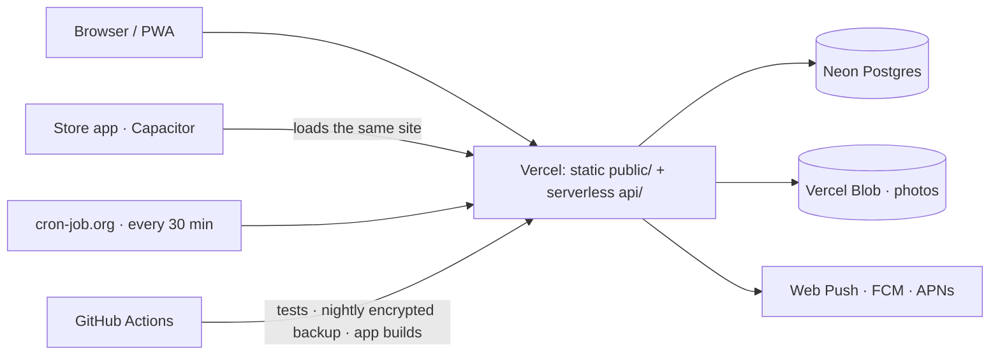

# TT

**English** · [한국어](README.ko.md)

An open-source shared calendar for two people that **you run yourself** — so your
plans stay in your own database, not on a couple-app company's server. Each of
you signs in, one invites the other, and from then on you share a calendar. When
one of you adds something, it shows up on the other's lock screen, and on the
morning of the day it speaks up again. No KakaoTalk, no Slack — the app sends the
push itself.

<p align="center">

</p>

| | |
|---|---|
| **In one line** | A couples' calendar you host yourself in 15 minutes, for free — your data in your own Postgres. Plain JavaScript, no framework, no build step |
| **Live** | [tt-calendar.vercel.app](https://tt-calendar.vercel.app) is the author's own copy · [what it is](https://tt-calendar.vercel.app/en/) · [days-together calculator](https://tt-calendar.vercel.app/en/days-together/) |
| **Demo** |  · [mp4](docs/demo/demo.mp4) — 25 s, a demo couple on the live service |
| **Status** | Open source (MIT). Runs on the web as a PWA; the Capacitor store shells build in CI but are not published. Run your own: [no-code guide](docs/GUIDE.md) · [for coding agents](AGENTS.md) · [keeping it running](docs/RUNNING.md) |
| **Stack** | Vanilla JS · Vercel serverless (12 functions max, enforced by a test) · Neon Postgres · Vercel Blob · Web Push / FCM / APNs · Capacitor |
| **Tests** | 733, `npm test` (the real handlers against an in-memory Postgres, the screen, i18n, holidays, service worker, public pages) |
| **Cost** | $0 a month (free tiers) |
| **Read next** | [How it works](#how-it-works) · [Why it is built this way](#why-it-is-built-this-way) |

<p>


</p>

- **No build step.** No bundler, no framework. `public/` is served as-is
- **Three runtime dependencies** — `@neondatabase/serverless`, `web-push`,
  `@vercel/blob`. Android (FCM) and iPhone (APNs) notifications are plain `fetch`
  and Node's `http2`, not SDKs
- **Accounts and one calendar per couple** — Google only, no passwords (the ID
  token is checked against Google’s keys with plain `crypto`; native account
  chooser in the Android app), invite links and account deletion. Every query is scoped to the
  couple, and a two-couple test knocks on every endpoint to prove it
- **Store apps** — thin Capacitor shells (`android/`, `ios/`) with native
  notifications, built in CI without a Mac ([docs/APPS.md](docs/APPS.md))
- **iOS web push actually works**, including silent re-subscription when Safari
  drops it
- **Reminders** — about half an hour to an hour before anything with a time, and
  one summary of the day at 8am. In your own time zone
- **The "Us" tab** (bottom tab, next to the calendar) — a question of the day (your partner's answer opens once you
  have answered too; at 8pm whoever hasn't answered gets a nudge), a photo diary
  and album with "one year ago today" in the morning summary, a bucket list, a
  date ledger, food and culture logs, a map of your places, a "poke" (three a day)
  and location sharing (only while *both* of you have it on, only the last spot,
  deleted the moment you turn it off). One extra serverless function: `api/together.js`
- **Nine languages** — English, Korean, Japanese, Simplified Chinese, Spanish,
  French, German, Brazilian Portuguese and Russian — with i18n that needs no
  library; a language pack is a plain object in one file
- **First run is one screen, one thing to do** — Google sign-in → "what should we
  call you?" (your Google first name already filled in) → adding it to the home
  screen once (one tap to the system install prompt on Android; three picture steps
  on iPhone, since Safari lets no page install itself) → the guide. Opens like an app from the home screen (PWA)
- **Public pages for search engines and AI assistants** — an about page and a
  days-together calculator in all nine languages, generated by `landing.mjs`
  with FAQ structured data, hreflang, a sitemap and `llms.txt`

About 15,000 lines across `api/`, `lib/` and `public/` (nine language packs
included), with 435 integration tests that run the real handlers against an
in-memory Postgres, 224 that run the screen itself, 58 for i18n and holidays,
and 16 for the service worker.

## Your data stays with you

Most couple apps keep your diary, photos and plans on the company's servers. TT is
meant to be **deployed by the two of you** ([no-code guide](docs/GUIDE.md), about
15 minutes, free):

- **Your own database.** Plans, notes and photos go to the Neon Postgres and
  Vercel Blob store on *your* accounts. No one else — including the author of
  this code — has access to them, and deleting the project and the database
  removes all of it
- **No analytics, no ads, no trackers.** There is no third-party script that
  watches what you do. The page loads two fonts (Google Fonts, jsDelivr) and
  Google's sign-in button; those see the request, not your calendar. Opening the
  map in the "Us" tab also loads MapLibre from unpkg and map data from
  `tiles.openfreemap.org` (OpenStreetMap data) — they see which area you are looking at, never your
  pins or locations, which are drawn in your browser
- **Location sharing is opt-in, both ways.** Your position is only sent while the
  "Us" tab is open with sharing on, at most once a minute; only the latest spot is
  kept, your partner sees it only if they share too, and turning it off deletes it
- **Google only checks who you are.** Sign-in sends an ID token that your server
  verifies with Google's public keys. Your events never go to Google
- **Notifications are end-to-end encrypted on the web.** Web Push payloads are
  encrypted for the receiving browser (`aes128gcm`), so the push service relays
  them without being able to read them. (The optional store apps use FCM and
  APNs, which do not encrypt this way — they are not published, and the web app
  doesn't need them)
- **Open code.** Every query is scoped to your couple, and `test.mjs` runs two
  couples against every endpoint to prove nothing leaks between them — read it

The hosting companies (Vercel, Neon) still run the machines, as with any cloud
app; the difference is that the data sits in an account *you* own, not in a
service that holds everyone's.

## How it works



| Piece | What it does here | Where |
|---|---|---|
| **Vercel** | Serves `public/` as-is and runs `api/` as serverless functions. One deployment for every couple; pushing to `main` deploys | `vercel.json`, `api/` |
| **Neon Postgres** | Eighteen tables, every calendar row keyed by `couple_id`. Each preview deployment gets its own database branch, so testing never touches real calendars | `schema.sql`, `lib/store.js` |
| **Vercel Blob** | Calendar photos, private; the database keeps only where each one is | `lib/blob.js` |
| **Outside clock** | Knocks on `/api/cron` every 30 minutes for "starting soon", the 8am summary and the 8pm question of the day, read in each calendar's own time zone | `api/cron.js`, `lib/remind.js` |
| **Encrypted backup** | GitHub Actions dumps the database every night and encrypts it with GPG before keeping it for 30 days — the repo is public, so the artifact has to be useless without the passphrase | `.github/workflows/backup.yml` |
| **PWA** | Manifest, a service worker that opens the app with no signal, an install button on Chrome/Edge and picture steps on iPhone | `public/sw.js`, `api/manifest.js` |
| **Store apps** | Capacitor shells around the same site with native notifications. The Android `.aab` and the iOS TestFlight build come out of CI, no Mac | `android/`, `ios/`, `.github/workflows/` |

## Why it is built this way

- **No framework, no build step.** The screen is one HTML file, one script and one
  stylesheet. There is nothing to upgrade or break between deploys, and the
  store apps load the very same files
- **Three runtime dependencies.** FCM and APNs are a signed JWT plus `fetch`
  (or Node's `http2` for Apple). Google sign-in checks the ID token against
  Google's public keys with `crypto`. Each SDK skipped is one less thing to
  audit and keep current
- **One service, many couples, isolation tested.** Every function in
  `lib/store.js` takes the couple first, and who sits in which seat comes from
  the session, never from the request body. A two-couple test knocks on every
  endpoint to prove one couple cannot see the other's calendar
- **Google only, no passwords.** Nothing to leak, nothing to reset. Sign-in is an
  HttpOnly cookie; sessions and invite codes are stored only as hashes
- **The app sets itself up.** The first request runs `schema.sql` and makes the
  VAPID keys, and runs the schema again whenever the file changes. A fresh
  deploy needs one database URL and nothing else
- **Tests against a real Postgres, in memory.** PGlite runs the actual SQL, so
  `npm test` needs no accounts and runs on every push. The screen is tested by
  running `public/app.js` against a stub DOM
- **Built for the free tier.** A knock every 30 minutes lets Neon sleep between
  knocks (about 30 of the 100 free compute hours a month), and a test keeps the
  deploy within Vercel's 12-function limit
- **Reminders are pure functions of the clock**, so tests can put in any time,
  including midnight and time zones west of UTC
- **Written for a stranger.** Every user-visible string goes through the
  language packs, and [`AGENTS.md`](AGENTS.md) lets a coding agent install it
  without the author

## Install

### Never used a terminal?

Follow [**the step-by-step guide**](docs/GUIDE.md). It's all in the browser —
one Deploy button, about 5 minutes. The app makes its own keys and tables the
first time it runs. That sets up a copy for the two of you.

### Let an agent do it (easiest)

Clone the repo, open a CLI coding agent in that folder — Claude Code, Codex,
whatever you use — and ask:

```
how do I use this?
```

[`AGENTS.md`](AGENTS.md) spells out the setup in a form agents can execute. You
pick a project name; it handles the rest. The only thing you do by hand is one
browser login (`vercel login`).

### By hand

Five minutes if you already have the accounts. You don't need to sign up for
Neon separately — the Vercel integration creates the account for you.

```bash
npm install
npx vercel login
npx vercel link --yes
npx vercel integration add neon        # this sets DATABASE_URL

npx vercel env pull .env.local
npm run verify                         # fix every ✗, read every ⚠
npx vercel deploy --prod
```

Nothing else is required. The VAPID keys for push are made by the app on its
first request and kept in the database (`lib/setup.js`), and the tables are
created the same way. Optional extras — a Blob store for photos, a Google
client ID for Google sign-in, `CRON_SECRET` for the morning clock, and the FCM/APNs keys
for the store apps — are listed in [`AGENTS.md`](AGENTS.md#first-install).

**Letting other couples sign up is running a service.** Vercel's Hobby plan is
for personal use only, so that needs Vercel Pro, and a paid Neon plan once the
clock runs around the clock ([`docs/RUNNING.md`](docs/RUNNING.md)).

When `npm run verify` prints a ✗ it also prints the command that fixes it.

## Turning on notifications

**Settings → phone notifications → allow.** Once per device. Or install the
store app, which asks on its own.

**On iPhone this only works from a home-screen app.** The button does nothing in
a Safari tab. Share → "Add to Home Screen" → open it from that icon, then allow.
(iOS 16.4+)

Android and desktop Chrome just work.

### Reminders on the day

Events also announce themselves on the day itself: a **"starting soon"** reminder
30–60 minutes before anything with a time, and **one summary at 8am** of the day.
Both of you get these. They need one more piece of setup — something has to knock
on `/api/cron` every 30 minutes (Vercel Cron on Pro, or an outside service). The key is
`CRON_SECRET`, known only to whoever runs the service.
[`AGENTS.md`](AGENTS.md#reminders-on-the-day) walks through it.

The time zone that decides "today" and "8am" lives in each calendar's settings.
The app fills it in from your browser the first time you open it.

## Making it yours

**From the settings screen** — app name, greeting, both names, the day you met,
theme, calendar photos. No code involved. **There is no save button;** typing or
picking commits it.

**Files you can swap**

| File | Where it shows up |
|---|---|
| `public/mascot.png` | the big image on the login screen |
| `public/favicon.png` | browser tab · notification icon |
| `public/badge.png` | the status-bar icon on Android |

`badge.png` has one rule. **Android uses only the alpha channel** — it paints the
shape with its own color. A color photo turns into a smudge. Export it at 96px,
white on transparent.

**Things that need a code change**

- **A new theme** — copy a `[data-theme="..."]` block in `style.css`, change the
  values, add the id to the `THEMES` array in `app.js`, and add a `theme.<id>`
  key to the language packs. The swatch in the picker builds itself
- **The default home-screen name and icon** — `public/manifest.default.json` and
  `public/icon-512.png`. Each couple can pick their own name and icon in the app
  (asked once on first sign-in, then Settings → Home-screen icon); `api/manifest.js`
  serves `/manifest.json` with their choice

## Language

The app ships in nine languages; **Language** in settings switches both screens,
since it is a shared setting. Until someone picks one, it follows the browser's
language. Dates, times and weekday names come from
`Intl`, so they follow the language without anyone writing them down.

A language pack is one file of plain key–value pairs — no library, no build:

```
public/i18n/en.js     the reference pack
public/i18n/ko.js     ja.js · zh-CN.js · es.js · fr.js · de.js · pt-BR.js · ru.js
```

To add one, copy `en.js`, translate the values, add a `<script>` for it in
`index.html`, add the tag to `LOCALE_NAMES` in `i18n/index.js`, and import it in
`lib/i18n.js` so notifications get it too. Anything you
leave out falls back to English rather than showing blank. `npm run i18n` prints
how complete each pack is.

The server uses the same files, so push notifications arrive in the language the
calendar is set to.

## Holidays

**Holidays** in settings picks a country. Each one is a file that maps dates to
name keys:

```
public/holidays/none.js   the default
public/holidays/calc.js   Easter and "nth weekday" rules the sets below share
public/holidays/kr.js     South Korea, incl. lunar dates and substitute days
public/holidays/jp.js     Japan, incl. substitute and citizens' holidays
public/holidays/cn.js     mainland China, statutory days (lunar dates to 2036)
public/holidays/us.js     US federal holidays, incl. observed days
public/holidays/de.js     Germany, nationwide holidays only
public/holidays/fr.js     metropolitan France
public/holidays/es.js     Spain, national holidays only
public/holidays/br.js     Brazil, national holidays
public/holidays/ru.js     Russia, the holidays themselves
```

Each file's header says what it leaves out — regional holidays, and days off
that a government moves by decree each year (China's swapped weekends, Russia's
transfers) cannot be computed. **Adding your own country is the most useful
thing you can contribute** — copy `kr.js`, keep the shape (including the
wrapper), register it under a short code, load it in `index.html`, and add
`region.<code>` plus the holiday names to the language packs.

## Things worth knowing

- **The first request takes a second or two.** Neon sleeps after five idle
  minutes and wakes on the next query. That's the price of the free tier, and
  the reason it stays free
- **Sign-in is a cookie the page cannot read** (HttpOnly, SameSite). There are no
  passwords; sign-in and invite tokens are stored only as hashes
- **You don't get notified about your own edits.** Only the other person does
- **iOS web push dies quietly sometimes.** The app re-subscribes on open when it
  notices the subscription is gone; if notifications still don't arrive, toggle
  them off and on in settings

Longer-term operational notes — free-tier limits, environment variables you must
not touch, things that rot over time — are in [`docs/RUNNING.md`](docs/RUNNING.md).

## Layout

```
api/                serverless functions (thin handlers)
lib/                store.js calendar SQL · accounts.js account SQL · http.js sessions
                    push.js · fcm.js · apns.js notifications · blob.js photos
public/             the UI. served as-is, no build
public/i18n/        language packs
public/holidays/    holiday sets, one file per country
public/privacy.html privacy policy (a draft — fill in the blanks)
android/ ios/       Capacitor shells for the store apps
fastlane/ .github/  store builds in CI, no Mac needed
schema.sql          eighteen tables — the app runs it itself on first start
landing.mjs         builds the public pages (words in landing-content.mjs)
test.mjs            435 integration tests against the real handlers
screen-test.mjs     224 tests that drive public/app.js: sign-in, editor, settings, app push, install
```

```bash
npm test      # runs the real handlers against in-memory Postgres. No Neon account needed
npm run verify
```

## Contributing

Holiday sets and language packs are the most useful things you can send — both
are a single self-contained file. See the two sections above.

```bash
npm test        # handler tests plus the screen, no accounts needed
npm run i18n    # how complete each language pack is
```

## License

MIT — use it, fork it, run it for the two of you. See [LICENSE](LICENSE).
