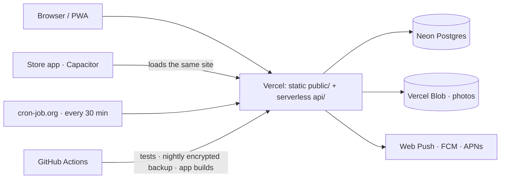

# TT

**English** · [한국어](README.ko.md)

A shared calendar for two people, run as one service for many couples. Each of
you signs up, one invites the other, and from then on you share a calendar. When
one of you adds something, it shows up on the other's lock screen, and on the
morning of the day it speaks up again. No KakaoTalk, no Slack — the app sends the
push itself, to the browser or to the iOS and Android apps.

| | |
|---|---|
| **In one line** | A shared calendar for couples, run as one multi-tenant service — plain JavaScript, no framework, no build step |
| **Live** | [tt-calendar.vercel.app](https://tt-calendar.vercel.app) · [what it is](https://tt-calendar.vercel.app/en/) · [days-together calculator](https://tt-calendar.vercel.app/en/days-together/) — free beta |
| **Demo** |  · [mp4](docs/demo/demo.mp4) — 25 s, a demo couple on the live service |
| **Status** | Running on the web as a PWA. Store apps are built in CI and wait on a D-U-N-S number for the Play organisation account |
| **Stack** | Vanilla JS · Vercel serverless (12 functions max, enforced by a test) · Neon Postgres · Vercel Blob · Web Push / FCM / APNs · Capacitor |
| **Tests** | 540, `npm test` (the real handlers against an in-memory Postgres, the screen, i18n, holidays, service worker, public pages) |
| **Cost** | $0 a month (free tiers) |
| **Diagram** | [How it works](#how-it-works) |

<p>


</p>

- **No build step.** No bundler, no framework. `public/` is served as-is
- **Three runtime dependencies** — `@neondatabase/serverless`, `web-push`,
  `@vercel/blob`. Android (FCM) and iPhone (APNs) notifications are plain `fetch`
  and Node's `http2`, not SDKs
- **Accounts and one calendar per couple** — Google only, no passwords (the ID
  token is checked against Google’s keys with plain `crypto`; native account
  chooser in the Android app), invite links and account deletion. Every query is scoped to the
  couple, and a two-couple test knocks on every endpoint to prove it
- **Store apps** — thin Capacitor shells (`android/`, `ios/`) with native
  notifications, built in CI without a Mac ([docs/APPS.md](docs/APPS.md))
- **iOS web push actually works**, including silent re-subscription when Safari
  drops it
- **Reminders** — about half an hour to an hour before anything with a time, and
  one summary of the day at 8am. In your own time zone
- **Nine languages** — English, Korean, Japanese, Simplified Chinese, Spanish,
  French, German, Brazilian Portuguese and Russian — with i18n that needs no
  library; a language pack is a plain object in one file
- Add to home screen and it opens like an app (PWA), with an install prompt on
  Chrome/Edge and Share → Add to Home Screen steps on iPhone
- **Public pages for search engines and AI assistants** — an about page and a
  days-together calculator in all nine languages, generated by `landing.mjs`
  with FAQ structured data, hreflang, a sitemap and `llms.txt`

About 12,500 lines across `api/`, `lib/` and `public/` (nine language packs
included), with 344 integration tests that run the real handlers against an
in-memory Postgres, 122 that run the screen itself, and 58 more for i18n and
holidays.

## How it works



- One deployment serves every couple; each request is scoped to the signed-in
  couple, and preview deployments get their own copy of the database
- Reminders are pure functions of the clock (`lib/remind.js`), so tests can put
  any time in; an external cron knocks every 30 minutes so the database can sleep
  between knocks and stay in the free tier

## Install

### Never used a terminal?

Follow [**the step-by-step guide**](docs/GUIDE.md). It's all in the browser —
one Deploy button, about 5 minutes. The app makes its own keys and tables the
first time it runs. That sets up a copy for the two of you.

### Let an agent do it (easiest)

Clone the repo, open a CLI coding agent in that folder — Claude Code, Codex,
whatever you use — and ask:

```
how do I use this?
```

[`AGENTS.md`](AGENTS.md) spells out the setup in a form agents can execute. You
pick a project name; it handles the rest. The only thing you do by hand is one
browser login (`vercel login`).

### By hand

Five minutes if you already have the accounts. You don't need to sign up for
Neon separately — the Vercel integration creates the account for you.

```bash
npm install
npx vercel login
npx vercel link --yes
npx vercel integration add neon        # this sets DATABASE_URL

npx vercel env pull .env.local
npm run verify                         # fix every ✗, read every ⚠
npx vercel deploy --prod
```

Nothing else is required. The VAPID keys for push are made by the app on its
first request and kept in the database (`lib/setup.js`), and the tables are
created the same way. Optional extras — a Blob store for photos, a Google
client ID for Google sign-in, `CRON_SECRET` for the morning clock, and the FCM/APNs keys
for the store apps — are listed in [`AGENTS.md`](AGENTS.md#first-install).

**Letting other couples sign up is running a service.** Vercel's Hobby plan is
for personal use only, so that needs Vercel Pro, and a paid Neon plan once the
clock runs around the clock ([`docs/RUNNING.md`](docs/RUNNING.md)).

When `npm run verify` prints a ✗ it also prints the command that fixes it.

## Turning on notifications

**Settings → phone notifications → allow.** Once per device. Or install the
store app, which asks on its own.

**On iPhone this only works from a home-screen app.** The button does nothing in
a Safari tab. Share → "Add to Home Screen" → open it from that icon, then allow.
(iOS 16.4+)

Android and desktop Chrome just work.

### Reminders on the day

Events also announce themselves on the day itself: a **"starting soon"** reminder
30–60 minutes before anything with a time, and **one summary at 8am** of the day.
Both of you get these. They need one more piece of setup — something has to knock
on `/api/cron` every 30 minutes (Vercel Cron on Pro, or an outside service). The key is
`CRON_SECRET`, known only to whoever runs the service.
[`AGENTS.md`](AGENTS.md#reminders-on-the-day) walks through it.

The time zone that decides "today" and "8am" lives in each calendar's settings.
The app fills it in from your browser the first time you open it.

## Making it yours

**From the settings screen** — app name, greeting, both names, the day you met,
theme, calendar photos. No code involved. **There is no save button;** typing or
picking commits it.

**Files you can swap**

| File | Where it shows up |
|---|---|
| `public/mascot.png` | the big image on the login screen |
| `public/favicon.png` | browser tab · notification icon |
| `public/badge.png` | the status-bar icon on Android |

`badge.png` has one rule. **Android uses only the alpha channel** — it paints the
shape with its own color. A color photo turns into a smudge. Export it at 96px,
white on transparent.

**Things that need a code change**

- **A new theme** — copy a `[data-theme="..."]` block in `style.css`, change the
  values, add the id to the `THEMES` array in `app.js`, and add a `theme.<id>`
  key to the language packs. The swatch in the picker builds itself
- **The label under the home-screen icon** — `public/manifest.json`. It does not
  follow the setting

## Language

The app ships in nine languages; **Language** in settings switches both screens,
since it is a shared setting. Until someone picks one, it follows the browser's
language. Dates, times and weekday names come from
`Intl`, so they follow the language without anyone writing them down.

A language pack is one file of plain key–value pairs — no library, no build:

```
public/i18n/en.js     the reference pack
public/i18n/ko.js     ja.js · zh-CN.js · es.js · fr.js · de.js · pt-BR.js · ru.js
```

To add one, copy `en.js`, translate the values, add a `<script>` for it in
`index.html`, add the tag to `LOCALE_NAMES` in `i18n/index.js`, and import it in
`lib/i18n.js` so notifications get it too. Anything you
leave out falls back to English rather than showing blank. `npm run i18n` prints
how complete each pack is.

The server uses the same files, so push notifications arrive in the language the
calendar is set to.

## Holidays

**Holidays** in settings picks a country. Each one is a file that maps dates to
name keys:

```
public/holidays/none.js   the default
public/holidays/calc.js   Easter and "nth weekday" rules the sets below share
public/holidays/kr.js     South Korea, incl. lunar dates and substitute days
public/holidays/jp.js     Japan, incl. substitute and citizens' holidays
public/holidays/cn.js     mainland China, statutory days (lunar dates to 2036)
public/holidays/us.js     US federal holidays, incl. observed days
public/holidays/de.js     Germany, nationwide holidays only
public/holidays/fr.js     metropolitan France
public/holidays/es.js     Spain, national holidays only
public/holidays/br.js     Brazil, national holidays
public/holidays/ru.js     Russia, the holidays themselves
```

Each file's header says what it leaves out — regional holidays, and days off
that a government moves by decree each year (China's swapped weekends, Russia's
transfers) cannot be computed. **Adding your own country is the most useful
thing you can contribute** — copy `kr.js`, keep the shape (including the
wrapper), register it under a short code, load it in `index.html`, and add
`region.<code>` plus the holiday names to the language packs.

## Things worth knowing

- **The first request takes a second or two.** Neon sleeps after five idle
  minutes and wakes on the next query. That's the price of the free tier, and
  the reason it stays free
- **Sign-in is a cookie the page cannot read** (HttpOnly, SameSite). There are no
  passwords; sign-in and invite tokens are stored only as hashes
- **You don't get notified about your own edits.** Only the other person does
- **iOS web push dies quietly sometimes.** The app re-subscribes on open when it
  notices the subscription is gone; if notifications still don't arrive, toggle
  them off and on in settings

Longer-term operational notes — free-tier limits, environment variables you must
not touch, things that rot over time — are in [`docs/RUNNING.md`](docs/RUNNING.md).

## Layout

```
api/                serverless functions (thin handlers)
lib/                store.js calendar SQL · accounts.js account SQL · http.js sessions
                    push.js · fcm.js · apns.js notifications · blob.js photos
public/             the UI. served as-is, no build
public/i18n/        language packs
public/holidays/    holiday sets, one file per country
public/privacy.html privacy policy (a draft — fill in the blanks)
android/ ios/       Capacitor shells for the store apps
fastlane/ .github/  store builds in CI, no Mac needed
schema.sql          thirteen tables — the app runs it itself on first start
landing.mjs         builds the public pages (words in landing-content.mjs)
test.mjs            344 integration tests against the real handlers
screen-test.mjs     122 tests that drive public/app.js: sign-in, editor, settings, app push, install
```

```bash
npm test      # runs the real handlers against in-memory Postgres. No Neon account needed
npm run verify
```

## Contributing

Holiday sets and language packs are the most useful things you can send — both
are a single self-contained file. See the two sections above.

```bash
npm test        # handler tests plus the screen, no accounts needed
npm run i18n    # how complete each language pack is
```

## License

All rights reserved. See [LICENSE](LICENSE).
